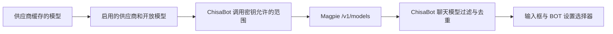

# Magpie 深度集成

[文档首页](README.md) · [模型配置与切换](models.md) · [部署说明](../deploy/README.zh-CN.md) · [维护与排错](operations.md)

Magpie 将多个模型服务、账户和路由规则放在一个网关后面。ChisaBot 保存一个网关连接，获取它开放的模型目录，再为每个 BOT 保存独立模型 ID。两边职责如下：

| ChisaBot | Magpie |
| --- | --- |
| 网页登录、BOT、对话与数据持久化 | 供应商连接、上游账户和访问密钥 |
| 聊天框及 BOT 设置中的模型选择 | 模型开放范围、账户路由与协议转换 |
| BOT 选择权限、工具权限和审计 | 上游额度、故障、模型可用状态与请求用量 |
| 本轮 BOT 模型快照与模型权限判断 | 将完整模型 ID 路由到相应供应商或路由组 |

ChisaBot 不去修改 Magpie 的每个客户端配置，也不从其私人配置文件读取上游密钥。模型目录与推理都使用 ChisaBot 保存的同一个网关连接。

## 部署 Magpie

Magpie 支持官方镜像、CLI 与 Web 界面。优先按本仓库 [部署模板](../deploy/README.zh-CN.md) 连接内部网络和登录网关，安装与版本细节参考 [Magpie 官方 Docker 说明](https://github.com/yetone/magpie/blob/main/docs/reference.md#docker) 与 [官方项目](https://github.com/yetone/magpie)。发布或长期运行时固定自己验证过的版本或镜像摘要。

| 接口 | 默认端口 | 用途 |
| --- | --- | --- |
| 模型网关 | `3425` | 模型目录与推理 API |
| Web 管理界面 | `3430` | 供应商、账户、调用密钥和设置 |

这两个接口不同。ChisaBot 的模型 API 地址应填写 `3425` 的网关前缀，管理入口应指向受到登录保护的 Web 界面，不能把 `3430` 的网页地址当作模型 API。

官方 CLI 的 Web 启动方式为：

```sh
magpie web --addr 0.0.0.0:3430 --no-open
```

该命令绑定容器或服务内部地址；哪些端口对外开放，以部署模板和反向代理配置为准。Web 管理密钥与模型网关调用密钥分别管理。不要把上游账户密钥或 Web 管理密钥填成 ChisaBot 的模型调用密钥。

服务端容器与 Magpie 位于同一网络时，可使用 `http://magpie:3425/v1`。服务名 `magpie` 只是模板示例，按自己的网络调整。容器内的 `127.0.0.1` 指容器自身，通常不能用它访问另一容器。

### ChisaBot 管理入口

设置构建期 `VITE_MAGPIE_MANAGEMENT_URL` 为自己受保护的 Magpie Web 管理地址，重新构建前端后，ChisaBot 管理页面会显示 **Magpie 模型管理** 入口。该值只提供公开网页链接，不是模型 API 基址，不影响目录或推理连接。

链接中不要包含 Web 管理密钥、上游密钥或账号密码；访问控制由网页登录网关及 Magpie 管理认证负责。未配置该值时不显示入口，模型 API 连接仍可按管理员设置运行。

## 配置顺序

1. 在 Magpie **供应商（Providers）** 中添加自己使用的模型服务或账户，启用需要的供应商。
2. 在 Magpie 中确认希望向客户端开放的模型。上游缓存中的模型不一定全部对外开放。
3. 创建供 ChisaBot 使用的独立调用密钥，设置它的模型范围及其他限制。
4. 在 ChisaBot **管理 → 模型配置** 中选择兼容协议，填写网关 API 基址、调用密钥以及一个完整的默认模型 ID。
5. 测试连接并保存。打开 BOT 的模型选择器刷新，确认看到需要的供应商与模型。
6. 为一个 BOT 选模型并发送简短消息，查看 Magpie 用量/请求记录中的实际模型与状态；再给另一个 BOT 选不同模型，确认两者独立。

要让 ChisaBot 可以选择网关当前开放的全部模型，需要将其专用调用密钥的模型范围设为 **全部模型**，清除原先只允许一个模型的限制。仍可以按部署需要保留调用密钥的额度和其他约束。该操作不等于启用所有供应商，也不会让被供应商配置隐藏的模型自动出现。

## 协议和地址

ChisaBot 的协议表示**它向网关发送的协议**，不要求所有上游都使用相同协议。Magpie 可以在支持的接口间转换，但具体上游是否支持工具、流式输出或某种内容，仍需要实际验证。

| ChisaBot 协议 | 推荐 API 基址示例 | 目录请求 | 测试连接 / 推理入口 |
| --- | --- | --- | --- |
| OpenAI 兼容 | `http://magpie:3425/v1` | `GET /v1/models` | `POST /v1/chat/completions` |
| Anthropic | `http://magpie:3425/v1` | `GET /v1/models` | `POST /v1/messages` |

OpenAI 兼容请求使用 `Authorization: Bearer …`。Anthropic 请求使用 `x-api-key` 和 `anthropic-version: 2023-06-01`。它们由 ChisaBot 服务端按保存的连接生成，用户浏览器不直接携带这些密钥请求 Magpie。

不要把 `/v1/chat/completions`、`/v1/messages` 或 Web 管理 URL 当作 API 基址。ChisaBot 会在基址之后追加具体操作路径，填操作地址会导致路径重复。没有路径的地址规范化为 `/v1`；非空自定义路径保留，适配自己的代理前缀时要确认实际路由。

上游文档中 Anthropic SDK 可能使用无 `/v1` 的 Magpie 根地址。本分支采用自己的基址规范化与操作拼接方式，以此处 ChisaBot 配置表为准。

## 目录与调用密钥

目录经过多层选择：



“全部”指当前网关向该调用密钥开放的目录。它不等于所有供应商缓存的总和，不包含已禁用或隐藏的模型，也不保证全部上游调用成功。

ChisaBot 保留完整 `provider/model` ID。不能把 `provider-a/model-x` 改成 `model-x`；前缀是 Magpie 路由的一部分，同名模型可能属于不同供应商。路由组等网关返回的完整 ID 也应原样保存。

目录获取仅使用已保存的连接；API 调用者不能指定新的 URL。服务端提供 30 秒缓存，选择器刷新对应 `GET /api/models?refresh=1`。更换连接或密钥后，缓存与旧连接隔离。目录投影与边界见 [模型目录实现](models.md#目录缓存和运行快照)。

## 每 BOT 选择与请求链路

ChisaBot 保存 `agents.override.model`，不会为每个 BOT 复制 Magpie 密钥。聊天输入框和 BOT 设置使用同一个服务端值，保存成功后同步，重启不会重置。

```text
用户选择完整 ID
  → ChisaBot 检查 BOT 权限与当前目录
  → 保存这个 BOT 的 model 覆盖值
  → 下一轮解析全局连接 + BOT 覆盖模型
  → 权限、用量判断和模型执行共用本轮快照
  → 按保存的协议请求 Magpie
  → Magpie 路由、转换并调用上游
  → 回复回到 ChisaBot 的持久化会话
```

正在输出的回复保持本轮已经解析的连接，切换影响后续轮次。路由选择、标题与语音摘要等辅助调用仍用部署默认模型。独立远程 AG-UI BOT 在其远程服务选择模型，不使用 ChisaBot 的本地覆盖。

## 用量与可用性验证

推荐用一条无工具的简短消息验证，随后分别检查：

1. BOT 设置返回的是选中的完整 ID。
2. Magpie 请求记录中的实际模型、上游状态和协议转换方向。
3. ChisaBot 收到正常完成事件，并能重新打开已保存回复。

目录获取成功，只验证了 `/models` 可访问。管理页面测试默认模型成功，也只验证了这个模型当时的短推理请求。完整对话、工具调用和其他模型仍需按实际使用场景验证。

Magpie 可能将请求在协议之间转换；确认实际模型 ID 比只查看客户端注册名称更可靠。ChisaBot 内部会为频道注册本地运行标识，但请求网关时应使用 BOT 的真实模型 ID。

## 常见问题

| 现象 | 检查顺序 |
| --- | --- |
| Magpie 有很多模型，ChisaBot 只有一个 | 供应商启用状态 → 开放模型 → ChisaBot 专用调用密钥是否限制为单模型 → 选择器刷新 |
| 模型列表 `401` / `403` | 是否用了网关调用密钥 → 该密钥是否启用 → 允许范围与网关访问限制 |
| 列表正常，某个模型 `403` | 完整 ID → 上游账户是否授权该模型 → Magpie 请求记录；目录出现不代表上游授权通过 |
| 找不到接口或模型 | API 基址是否为网关 `/v1` → 是否错误指向 GUI → 是否缺供应商前缀 |
| `429` 或间歇失败 | 调用密钥限额、上游账户额度、路由组规则与服务商状态 |
| 更换供应商后 BOT 仍用旧模型 | BOT 有独立覆盖值；重新选当前目录中的 ID，或选择“部署默认” |
| 列表加载失败但需要恢复默认 | 选择“部署默认”；清除覆盖值不依赖目录请求成功 |
| GUI 能打开，但应用连不到网关 | ChisaBot 服务端容器的网络/DNS/端口，不能以用户浏览器连通来代替服务端连通 |

一般运维检查、备份与升级见 [维护与排错](operations.md)。
